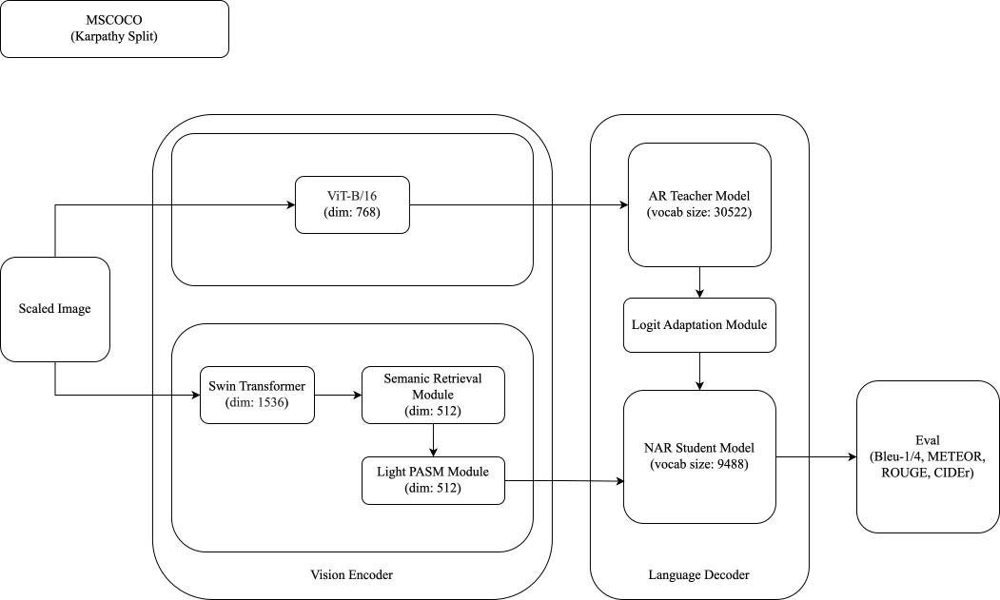

# DNAIC

<div align='center'>
  <h2>
    Distilled Non-Autoregressive Image Captioning
  </h2>
</div>

<div align='center'>
  
  
</div>

## Pipeline

<div align='center'>
    
</div>

## Data Preparation

- The dataset should be placed in the `mscoco/` directory

```bash
mscoco/
|--feature/
  |--coco2014/
    |--train2014/
    |--value2014/
    |--test2014/
|--misc/
|--sent/
|--txt/
```

Download link: [mscoco](https://pan.baidu.com/s/1KSYMOxvs-W6brrgpsZI9Aw?pwd=rain)

## Pre-trained Models Preparation

- Pre-trained models should be placed in the `pretrained_models/` directory

```bash
pretrained_models/
|-- mplug/
|-- swin-large-patch4-window12-384/
|-- vit/
```

Download link: [pretrained_models](https://pan.baidu.com/s/19h-6fc48hiyFZupPSf_vuQ?pwd=rain)

## Training Process

The model can be trained on NVIDIA GPU with CUDA support or Apple Silicon with MPS support (CPUs are not recommended). Training for 200 epochs takes approximately 20 hours on 8×A800-80GB GPUs.

1. Environment Setup

   Python 3.12

   ```bash
   pip install -r requirements.txt
   ```

2. Training Command

   ```bash
   bash experiments/train.sh
   ```

## Evaluation

1. Evaluation Script

   ```bash
   bash experiments/eval.sh
   ```

2. Evaluation Metrics
   - Image Captioning: BLEU, METEOR, ROUGE-L, CIDEr
   - Speed: Latency, SpeedUp

|            | BLEU-1 | BLEU-2 | BLEU-3 | BLEU-4 | METEOR | ROUGE-L | CIDEr  |
|------------|--------|--------|--------|--------|--------|----------|--------|
| EENAIC | 79.7   | 63.2   | 48.5   | 36.9   | 27.9   | 58.0     | 122.6  |
| DNAIC | 80.1   | 63.9   | 49.2   | 37.3   | 27.9   | 57.9     | 122.8  |

Download link: [DNAIC-base-0.2B](https://pan.baidu.com/s/1Gi55PFgfP5iTI0B5KF4yow?pwd=rain)

## Inference

1. Inference Performance

   ```bash
   bash experiments/inference.sh
   ```

2. WebUI

   A Gradio-based web UI is also provided for users to perform inference through a graphical interface.

   ```bash
   python webui.py
   ```

## Credits

This project is based on the following resources:

- MSCOCO
- mPLUG
- EENAIC

## License

This project is licensed under the terms specified in [LICENSE](LICENSE).
