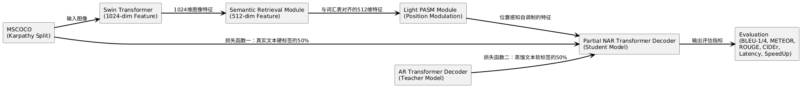

# Non-Autoregressive Image Captioning

<div align="center">
[](./LICENSE)
[]
</div>

## Pipeline

<div align='center'>
    
</div>

## Data Preparation

- The dataset should be placed in the `mscoco/` directory

```bash
mscoco/
|--feature/
  |--coco2014/
    |--train2014/
    |--value2014/
    |--test2014/
|--misc/
|--sent/
|--txt/
```

Download link: [mscoco](https://pan.baidu.com/s/1KSYMOxvs-W6brrgpsZI9Aw?pwd=rain)

## Pre-trained Models Preparation

- Pre-trained models should be placed in the `pretrained_models/` directory

```bash
pretrained_models/
|-- bert-base-uncased/
|   |-- config.json
|   |-- pytorch_model.bin
|   |-- special_tokens_map.json
|   |-- tokenizer_config.json
|   |-- vocab.txt
|-- mplug/
|   |-- mplug_base.pth
|-- swin-large-patch4-window12-384/
    |-- swin_large_patch4_window12_384_22kto1k_no_head.pth
```

Download link: [pretrained_models](https://pan.baidu.com/s/19h-6fc48hiyFZupPSf_vuQ?pwd=rain)

## Training Process

1. Environment Setup

   ```bash
   pip install -r requirements.txt
   ```

2. Training Command

   ```bash
   bash experiments/EENAIC/train.sh
   ```

## Evaluation

1. Evaluation Script

   ```bash
   bash experiments/EENAIC/eval.sh
   ```

2. Evaluation Metrics
   - Image Captioning: BLEU, METEOR, ROUGE-L, CIDEr

## Acknowledgments

This project is based on the following open-source projects:

- MSCOCO
- mPLUG
- EENAIC

## License

This project is licensed under the terms specified in [LICENSE](LICENSE).
